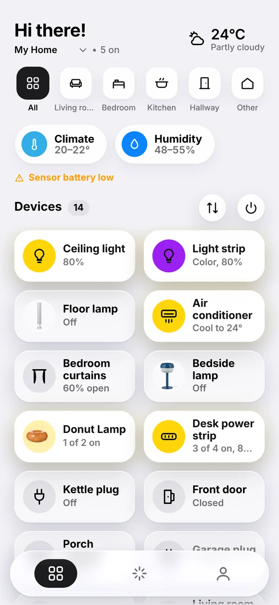
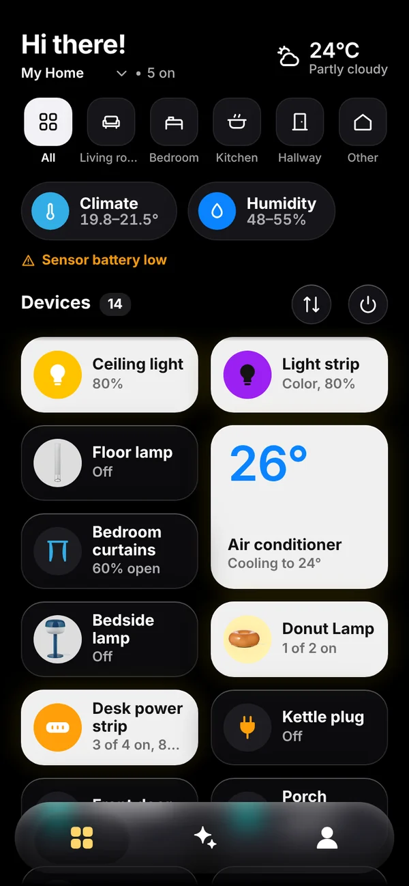
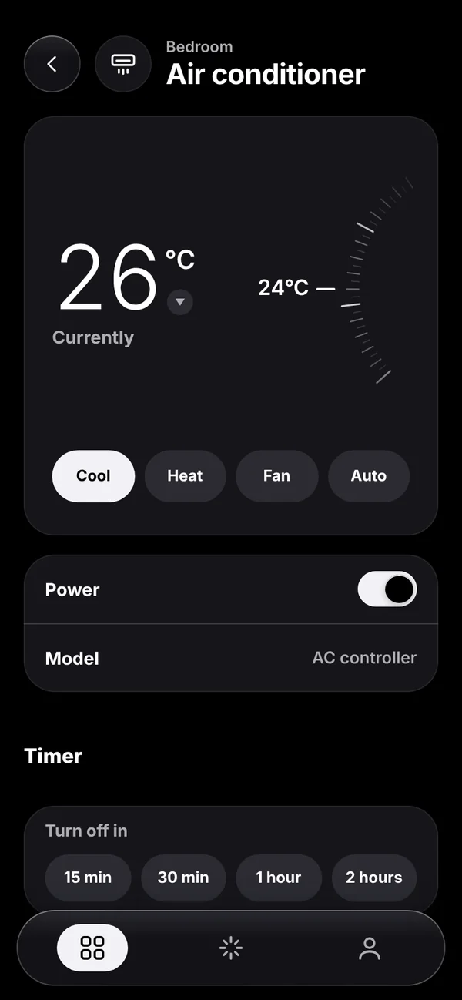
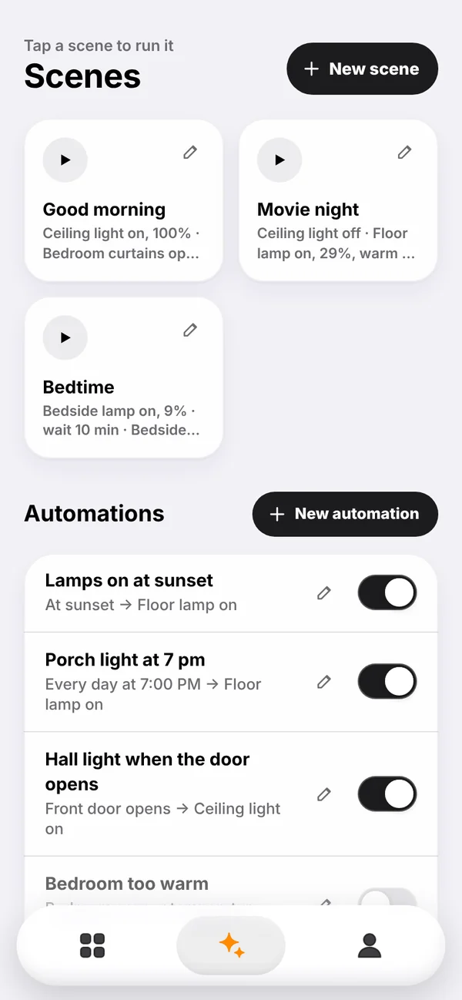
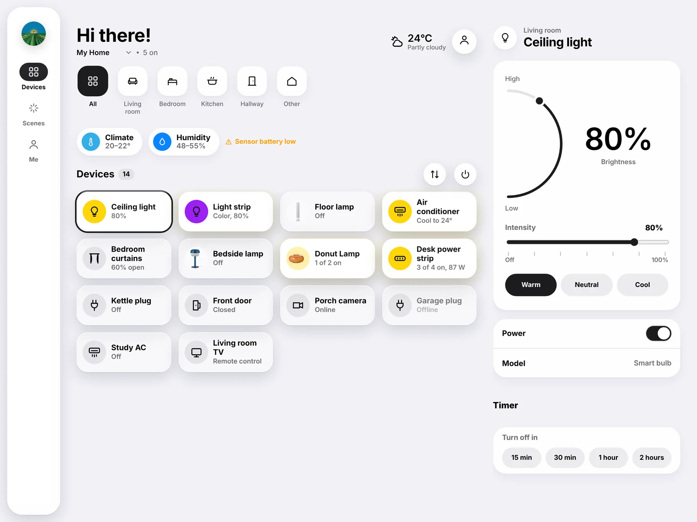
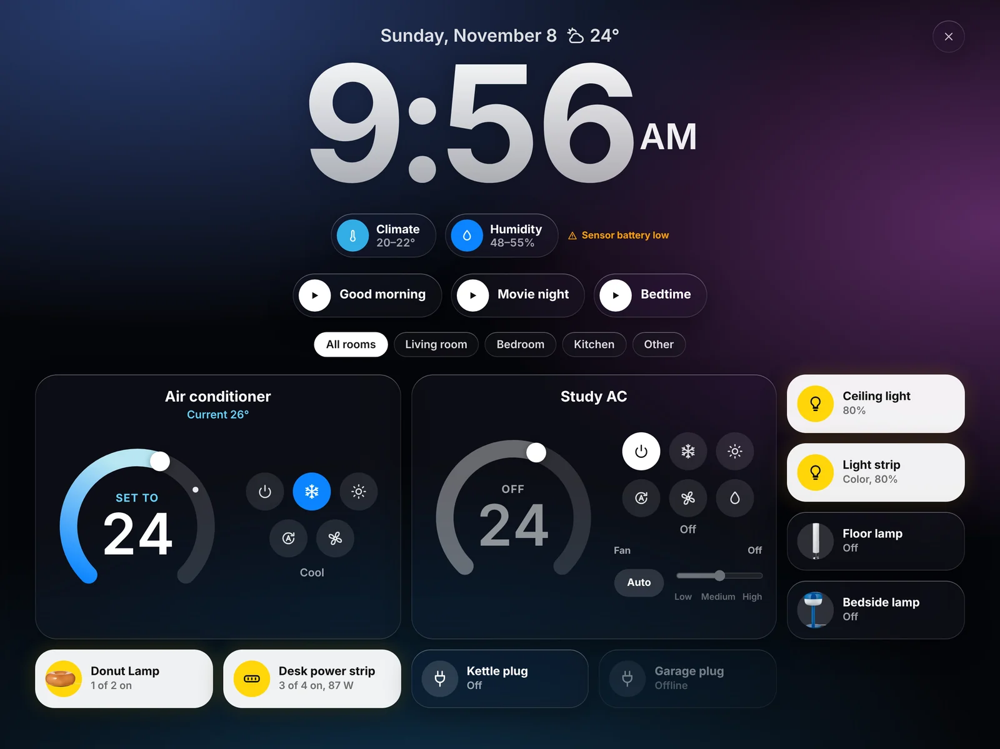
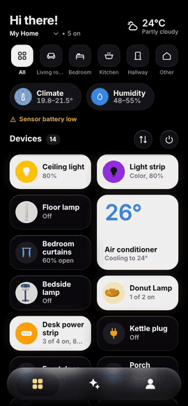
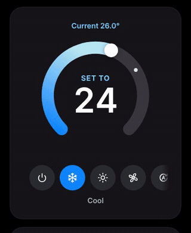
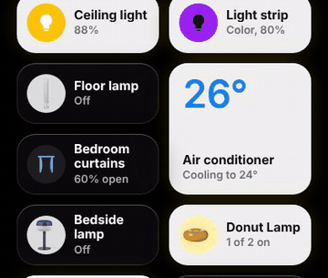
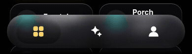

<p align="center">
  
</p>

<h1 align="center">Home</h1>

<p align="center">
  A minimal, fast web app for your Tuya smart home, installable on phones and tablets.<br>
  It talks to Tuya's official Cloud API through a small proxy that runs on Vercel,
  so your API secret never reaches the browser.
</p>

<p align="center">
  <a href="https://tuya-minimal.vercel.app/?demo"><b>Try the demo</b></a> ·
  <a href="#1-create-a-tuya-cloud-project">Set it up</a> ·
  <a href="CHANGELOG.md">Changelog</a>
</p>

## Screenshots

<p align="center">
  
  
  
  
  
</p>

<p align="center">
  
  
  
  
</p>

<p align="center">
  
</p>

<p align="center">
  
</p>

<p align="center"><sub>Screenshots from demo mode (<code>/?demo</code>), which uses sample devices.</sub></p>

## See it move

<table>
  <tr>
    <td align="center" width="50%"><br><sub><b>Long-press a tile</b> for a quick control: a sliding switch, or a brightness pill for dimmable lights</sub></td>
    <td align="center" width="50%"><br><sub><b>Thermostat</b>: drag the arc; the colour follows the mode</sub></td>
  </tr>
  <tr>
    <td align="center"><br><sub><b>Rooms</b>: tap a room to see its devices grouped like the Home app</sub></td>
    <td align="center"><br><sub><b>Blinds</b>: the fabric follows the motor; Open, Stop and Close below</sub></td>
  </tr>
  <tr>
    <td align="center"><br><sub><b>Switching</b> lights up the tile and fills the icon with colour</sub></td>
    <td align="center"><br><sub><b>Tab bar</b>: the capsule lifts into a glass lens and glides between tabs</sub></td>
  </tr>
</table>

## Features

- Phone layout with bottom tabs, tablet layout with a side rail and a controls panel
- Lights (on/off, brightness, warm/neutral/cool), plugs and switches, multi-outlet devices
  (power strips, 2-gang switches, USB ports: control each outlet or all at once, and rename them), air conditioners
  and thermostats, curtains, fans, sensors (door, motion, leak, smoke, temperature/humidity)
- IR blasters: each remote you set up (AC, TV, fan...) appears as its own device; ACs get
  temperature, mode and fan controls, other remotes get their buttons
- RGB color for color bulbs and light strips: an iOS-style color wheel, preset colors and a brightness bar
- "All off" for the whole home or the selected room
- People: give family members their own password (admins and members), and sync icons across devices
- Greeting with the current weather at your home (from the home's address in the Tuya app,
  via the free Open-Meteo service; Celsius by default, switchable in Me)
- Energy for plugs that measure power: live watts on the card, and on the plug's screen volts/amps,
  a 7-day chart, today, last 7 days and all-time kWh (from Tuya's data statistics)
- Pull down to refresh
- Device photos (Me → Device icons → Photos): product pictures from `public/devices/` shown on cards and
  device screens. To add more, drop a transparent WebP/PNG in that folder and list it in `PHOTOS` in app.js.
- Activity log (Me → Activity): who controlled which device, ran scenes, switched automations,
  edited scenes/automations, changed people or signed in, kept for 30 days. Needs the database.
- Optional "You're 12 km from home" under the greeting (Me → Appearance → Distance from home). The phone's
  location is compared with the home's location on the phone itself and never sent to the server.
- Readings: temperature/humidity (and CO₂, PM2.5) sensors appear as a strip of readings above
  your devices instead of as cards, including IR blasters with a built-in thermometer
- Sensor history charts (24 hours or 7 days) you can drag across, like Apple Health: the reading and time at your finger, with temperature and humidity following the same moment. A mouse shows readings on hover, and the arrow keys step through them
- Tap-to-run scenes: run, create, edit, duplicate and delete them (devices, outlets, brightness, AC settings,
  curtains, waits); IR remotes can be used too (AC settings, or any remote button)
- Automations: create, edit and delete them (admins). When: a time on chosen days, or a device
  turning on/off, a door opening, motion, a leak or smoke, temperature or humidity above/below a value;
  match any or all. Then: device actions, waits, or running a scene. Switch any automation on or off.
  Weather and other conditions made in the Tuya app are kept when you edit.
- Several homes: switch between them from the home name at the top of Devices
- Custom device icons in Me → Device icons (synced when the database is set up)
- Arrange device cards: tap the **arrows** button above the cards, drag the handles, tap **✓** (saved per home, synced when the database is set up)
- Home app-style tiles: solid icons coloured by kind of device, thermostat tiles with the temperature in large numbers, and a long press for a quick control.
- Rooms as Home app-style capsules with filled room icons and live "3 on" counts; inside a room, devices are grouped under Climate, Lights, Shades, Security, Speakers & TVs and Switches & Outlets
- Full-screen device controls on phones, like the Home app: brightness pills, outlet pills, a thermostat dial, a TV remote, an air quality ring and a roller blind you drag; the gear opens the device's settings
- Air quality monitors: an AQI chip on Home (worked out from PM2.5/PM10 when the monitor doesn't give one) and every reading on the monitor's page
- On tablets, laptops and the wall tablet the AC, IR remotes and air quality monitors open full-screen like on a phone (other devices keep the side panel); the AQI chip opens the monitor's page
- The Climate and Humidity chips open like a device: a full-screen ring with the reading (or the average and range of several sensors, coloured by how it feels) and a tile per sensor that opens its history
- No air quality monitor? Home shows an Outdoor air chip instead: the AQI for your home's location from Open-Meteo (Copernicus data, free, no key), and tapping it opens a full-screen page like a monitor's: AQI ring plus PM2.5, PM10, ozone and NO₂
- Smart circuit breakers: live power, voltage and current, total energy, leakage current and trip alarms
- Hide devices from Home in Arrange (they keep working in scenes and automations)
- Automation list like the Home app's: trigger icon → the devices it controls, the trigger as the title, and an Enable switch in the editor
- Wall tablet mode (Me → Wall tablet mode): a full-screen clock, weather, climate readings, scenes, room pills, thermostat-style AC controls (drag the arc, pick a mode by symbol) and device buttons. It keeps the screen awake (where the browser allows), switches to a dim, warm night look from 22:00 to 06:00 (tap to wake), and you press and hold the ✕ for a second to leave. Bookmark `/#kiosk` to open straight into it.
- Wall tablet faces, like Apple's HomeView: swipe sideways (or tap the dots) between a Clock face, a Weather face (the temperature huge in frosted glass on a sky that matches the conditions, with the condition, high/low, sunrise or sunset, wind and humidity), a Home face (a 2×2 thermostat with ⌄ ⌃, a minimal analog clock and tiles showing Room · State; cream when on, frosted glass when off; press and hold to choose them) and All controls (the full dashboard). Everything scales with the screen. After 2 minutes without a touch it returns to the Clock face. From 22:00 to 06:00 a dim, warm night look shows just the clock, date and readings; tap to wake it for a minute
- Optional PIN unlock per device instead of typing the password (Me → Settings → Security)
- Light and dark mode, installable from Chrome or Safari
- Opens instantly from its saved copy, even on a slow connection or offline, and only redraws what changed when you tap a device
- Demo mode with sample devices: open `/?demo`

Not included: pairing new devices (keep using the Tuya app for that) and camera live view.

## Project layout

```
public/            the PWA (index.html, app.js, app.css, manifest, service worker, icons, fonts)
docs/              the logo and screenshots for this README (not deployed)
api/router.js      the only serverless function: every request goes to /api/router?r=<name>
api/_routes/       the endpoints (folders starting with _ aren't deployed as separate functions,
                   which keeps the project within the free plan's 12-function limit)
  state.js         homes, rooms, devices, scenes, automations
  status.js        live device states only (fast, one Tuya request)
  command.js       send commands to one device
  spec.js          value ranges for a device's controls
  scene.js         run a scene
  scene-edit.js    create, update or delete a tap-to-run scene (admins)
  automation.js    enable or disable an automation
  automation-edit.js  read, create, update or delete an automation (admins)
  rename.js        rename one outlet of a multi-outlet device
  ir.js            buttons and commands for IR remotes
  login.js         sign in with a password, returns a session
  logout.js        end this device's session
  users.js         manage people (admins), change your own password
  settings.js      shared settings such as custom icons
  energy.js        daily kWh for plugs that measure power: Tuya statistics, else the device's
                   energy report log, else an estimate from its wattage log
  irspec.js        which IR remote commands can be used in scenes and automations
  timer.js         one-off device timers ("turn off in 30 min") via Tuya cloud schedules
  history.js       sensor history charts from the device's report log
  activity.js      the activity log: who did what (needs the database)
  weather.js       current weather, today's high/low, sunrise/sunset, wind and humidity, and outdoor air quality at the home's location (Open-Meteo, cached 5 / 30 minutes)
api/_lib/          report-log paging, Tuya client and signing, sign-in, home access checks, scene/automation validation, Neon helpers
```

One dependency (the Neon database driver, installed by Vercel) and no build step. Runs on Node 22 (set in package.json).

## 1. Create a Tuya cloud project

1. Sign up at the Tuya Developer Platform (iot.tuya.com) with any email.
2. Go to **Cloud → Development → Create Cloud Project**.
   - Industry: Smart Home. Development method: Smart Home.
   - **Data center:** pick the same region your Tuya app account uses. If you are unsure,
     the Tuya app shows your region under Me → Settings → Account and Security.
3. Accept the API services it suggests during creation (IoT Core and Authorization are required).
4. Open the project's **Overview** tab and note the **Access ID/Client ID** and **Access Secret**.

## 2. Link your Tuya app account

1. In the project, open **Devices → Link App Account → Add App Account**. A QR code appears.
2. In the Tuya app on your phone, tap the scan icon (top right of the Home or Me tab) and scan it.
3. Your devices now appear under the project's **Devices** tab.
4. Find your **UID**: it's shown next to the linked account in the Link App Account list.

## 3. Deploy to Vercel

1. Put this folder in a GitHub repository (keep it private if you like), then on vercel.com
   choose **Add New → Project** and import it. Leave the build settings as they are;
   `vercel.json` already tells Vercel to serve `public/` and run `api/`.
   (Or, with the Vercel CLI installed: run `vercel` in this folder.)
2. In **Project → Settings → Environment Variables**, add:

| Name | Value |
|---|---|
| `TUYA_CLIENT_ID` | Access ID/Client ID from step 1 |
| `TUYA_CLIENT_SECRET` | Access Secret from step 1 |
| `TUYA_UID` | UID from step 2 |
| `TUYA_REGION` | `us` (Western America), `us-e` (Eastern America), `eu` (Central Europe), `eu-w` (Western Europe), `sg` (Singapore), `in` (India), or `cn` (China) |
| `APP_PASSWORD` | A long passphrase you choose. The app asks for it on each new device. |
| `TUYA_IR_HUB` | Optional. The device ID of your IR blaster, if the app can't find it by itself (comma-separate several). |
| `OWNER_NAME` | Optional. Your name for the greeting ("Hi Alex!"). Without it the owner sees "Hi there!". |

3. Redeploy (Deployments → ⋯ → Redeploy) so the variables take effect.
4. Open your `https://<project>.vercel.app` URL and enter your app password.

## 4. Install it

- **Android (Chrome):** menu → **Install app**, or Me → Settings → Install app inside Home.
- **iPhone/iPad (Safari):** Share → **Add to Home Screen**.
- **Optional APK:** paste your Vercel URL into PWABuilder (pwabuilder.com) and download the
  Android package. It wraps the same web app, so updates you deploy show up automatically.

## Live updates

Device states refresh every 4 seconds while the app is open (a light, single request), and after
you control something the app checks again within a couple of seconds. Rooms, scenes and
automations refresh once a minute. Change the speed in **Me → Settings → Live updates**: Tuya's free plan has
a monthly allowance of API calls, so pick Normal or Saver if you leave the app open on a wall
tablet all day. Nothing is polled while the app is in the background.

## Sync and users (optional)

Without a database, the app works as before: one password (`APP_PASSWORD`) and icons saved per browser.
Adding a free Neon Postgres database unlocks icon sync across devices and separate passwords for other people.

1. In your Vercel project, open the **Storage** tab and choose **Neon** (Serverless Postgres).
   Pick the free plan and connect it to this project.
2. Vercel adds `DATABASE_URL` to your environment variables automatically (`POSTGRES_URL` works too).
3. Redeploy. Vercel installs the Neon driver listed in `package.json`, and the app creates its one
   table (`tuyahome_kv`) by itself on first use. In the app, **Me** now shows **People**, and **Me → Settings** shows sync as **On**.

People:
- The owner signs in with `APP_PASSWORD` and is always an admin.
- Admins add people in **Me → People → Add a person** with a name, password and role.
  **Members** control devices, run scenes and switch automations. **Admins** can also create, edit
  and delete scenes and manage people.
- Everyone signs in with just their password, so each password must be unique.
- Admins can limit a member to one home: in **Me → People**, set their home to **Only <home>**.
  The server enforces it, so they can't see or control devices, scenes or automations in other homes.
  Admins always have every home.
- Signing in gives each device a session, so passwords aren't sent with every request.
  Removing a person signs them out everywhere within seconds. **Me → Sign out** ends a session.
- After 10 wrong passwords from one network, sign-in pauses for 15 minutes.

## Speed: put the server next to Tuya

Every screen update makes a few calls from your Vercel function to Tuya Cloud. By default Vercel runs
functions in Washington, D.C. (`iad1`). If your Tuya data center is far from there, each call
crosses an ocean, and opening the app can take a couple of seconds.

In Vercel: **Project → Settings → Functions → Function Region**, pick the region closest to your
`TUYA_REGION`, then redeploy:

| `TUYA_REGION` | Function region |
|---|---|
| `sg` (Singapore) | Singapore (`sin1`) |
| `in` (India) | Mumbai (`bom1`) |
| `eu` (Central Europe) | Frankfurt (`fra1`) |
| `eu-w` (Western Europe) | London (`lhr1`) or Paris (`cdg1`) |
| `us` (Western America) | San Francisco (`sfo1`) or Portland (`pdx1`) |
| `us-e` (Eastern America) | Washington, D.C. (`iad1`, the default) |
| `cn` (China) | Hong Kong (`hkg1`) |

If you use the Neon database, create it in (or move it to) the same region, because every request
checks your session there. **Me → Settings** shows how long the last full update took.

The app itself doesn't wait on the network to open: the installed app starts from the copy saved
on the device, shows your last known device states (not when PIN unlock is on, so nothing is
readable before you unlock), then fetches fresh ones. Polling pauses while
the app is in the background.

## Updates

See `CHANGELOG.md` (also in the app under Me → About → Version) for what changed in each release.

After you deploy a new version, the installed app downloads it in the background and reloads itself
once, at a quiet moment (never while you're typing, dragging a slider or editing a scene). Because
the app opens from its saved copy, the first launch right after a deploy can still show the previous
version for a moment, until that reload.

## Checking what's deployed

Open `https://your-project.vercel.app/version.json` to see which version Vercel is serving.
It should match the newest entry in `CHANGELOG.md`.

## Troubleshooting

- **"Finish setting up your server"**: an environment variable is missing or `TUYA_REGION`
  is misspelled. Fix it in Vercel, then redeploy.
- **"Tuya rejected the API credentials"**: the ID or secret is wrong, or the data center
  doesn't match `TUYA_REGION`.
- **No devices**: the app account isn't linked (step 2), or it was linked in a different data center.
- **Me → Needs attention shows "permission deny"**: the project lacks an API service for that
  section (often scenes or automations). In your cloud project open **Service API → Go to Authorize**
  and add the service that covers homes, scenes and automations, then refresh.
- **Everything stopped working after a month or so**: Tuya's free IoT Core plan has to be
  extended periodically. Check **Cloud → Cloud Services → IoT Core** and renew the trial.
- **Devices from another home appear, or Me shows "Home devices: permission deny"**: the project
  can't read which devices belong to each home, so the app falls back to room membership. Authorize
  the service covering homes (Service API → Go to Authorize), or assign every device to a room in the Tuya app.
- **An IR AC shows but the controls don't work**: the app couldn't find your IR blaster, so it falls
  back to Tuya's standard IR commands. Add `TUYA_IR_HUB` with the blaster's device ID (Tuya project →
  Devices → All Devices) and redeploy.
- **The IR blaster shows instead of its remotes, or Me shows "IR remotes ... permission deny"**:
  authorize the **IR Control Hub Open Service** in your cloud project (Service API → Go to Authorize).
- **Energy shows "Tuya refused the usage history"**: authorize the device log and data statistics
  services in your cloud project (Service API → Go to Authorize). Logs cover the last 7 days.
- **A temperature looks 10× off**: open that device once so the app loads its exact scale.

## Security notes

- The Access Secret only lives in Vercel's environment variables. Never put it in `public/`.
- Every API call requires `APP_PASSWORD`. Anyone with your URL **and** that password can control
  your devices, so make it long and don't reuse it. Lock the app from Me on shared devices.
- With a PIN set, the password is stored encrypted on the device (AES-GCM, key derived from the
  PIN with PBKDF2). After 5 wrong PINs it is erased and the password is needed again. A PIN guards
  the app on your phone; the server still only accepts the full APP_PASSWORD.
- The proxy only exposes the endpoints above, validates every ID and command, and never
  forwards device local keys or IP addresses to the browser.

## Local development

```
cp .env.example .env.local   # fill in your values
npx vercel dev               # serves the app and the API on http://localhost:3000
```

To work on the interface without credentials, open `public/index.html` through any static
server and add `?demo` to the URL.
